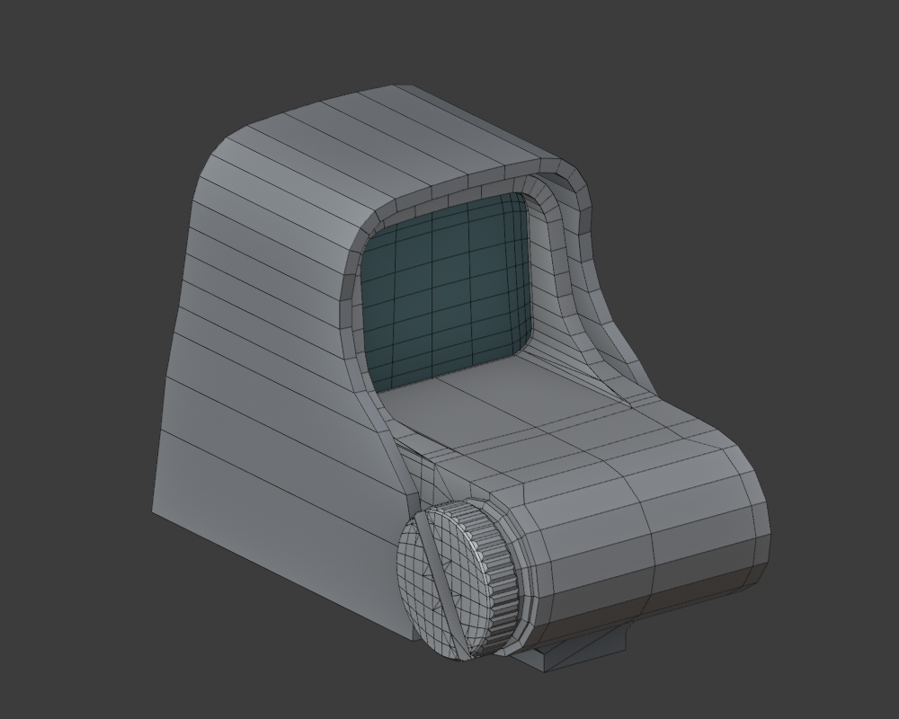

# Holosight — unfinished tutorial study

Open **Holosight.blend** to inspect the current saved scene in Blender 5.2. The working environment is preserved. No modeling changes were made for this repository upload.

## Current stage and review priorities

Episode 1, approximately 52 minutes: hood, inner housing, glass, side cap and screwdriver slot. The rail is an alignment placeholder. The model is not finished or certified as matching the tutorial. Tutorial observations came from sampled frames; they do not establish continuous viewing or exact reproduction of every operation.

1. **Cap face and slot:** the Boolean-assisted diagonal slot left extra triangles beside the face grid. Assess edge routing, lip width/depth, planar ngons and how the result would behave under the intended finishing method.
2. **Shoulder and circular nose:** inspect the long thin side strips, vertical termination and cap junction. Check the silhouette and cross-section before proposing extra loops or subdivision.
3. **Underside:** a prior cross-width twist was corrected. Verify the transition in several views rather than assuming the topology report proves it is correct.
4. **Glass and housing:** verify all corner radii, seating, thickness and front/rear alignment against the corresponding tutorial stage.

Some triangles are acceptable when they preserve the intended form and shading. A high quad percentage is not an acceptance criterion. One object is not necessarily a continuous mesh.

## Files

- `review/`: focused authored model and topology images. Tutorial captures in `review/tutorial-frames/` remain local and are not uploaded.
- `STATUS.md`: chronological construction history; later entries supersede earlier counts and claims.
- `validation.json`: last saved geometric checks, not a new audit or a visual quality certificate. The housing report records 1,085 faces, 976 quads, one evaluated component, no nonmanifold edges and no zero-area faces.
- `source/build.py`: rebuilds the named tutorial geometry in the existing project scene, then saves over `Holosight.blend`. Do not run it over unsynchronized manual changes. Open the existing blend first; this is not a standalone factory-scene initializer.
- `source/housing.py`, `cap.py`, `slot.py`: geometry constructors called by the build.
- `source/review_current.py`: run in a separate Blender process to generate temporary review renders; it never saves lighting/camera overrides to the working blend.
- `source/validate.py`: inspects the currently loaded project geometry and writes the report.
- `source/review_video.py`: local frame extraction using the original MP4 under the workspace `vids/` folder. Run separately; it changes the temporary scene's sequencer.

Rebuilding references requires the supplied `Essentials_Holosight/Reference/UWT2_Holosight_Tutorial.jpg` at the workspace root. Original video downloads and standalone reference assets are not distributed here. The saved working blend retains its packed reference imagery. Source materials remain the property of their authors; no rights to those materials are granted by this repository.

## Focused views

| Surface | Topology |
|---|---|
| [Cap](review/cap-close.png) | [Cap topology](review/cap-topology.png) |
| [Underside](review/underside.png) | [Underside topology](review/underside-topology.png) |
| [Housing profile](review/inner-side.png) | [Shoulder routing](review/shoulder-side.png) |

This upload packages the current checkpoint for critique; it does not complete the outstanding modeling work.
