# Exercise review gallery

These are stored study checkpoints; see each exercise note for limitations. The active task is the holosight.

## [bracket](bracket/README.md)

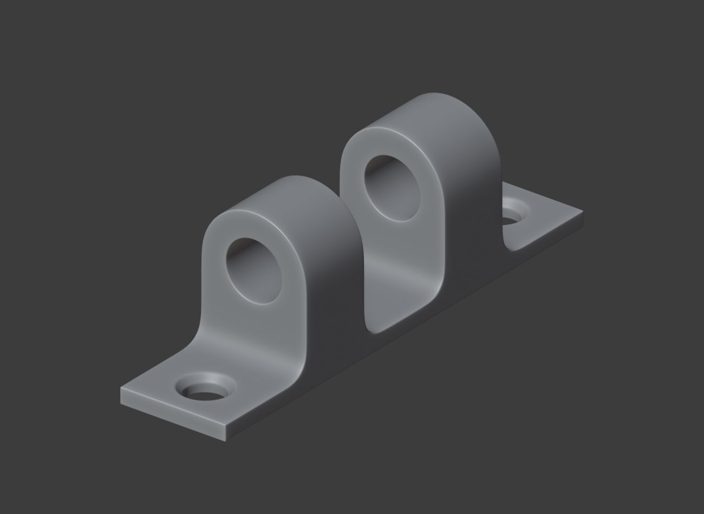

## [panel](panel/README.md)

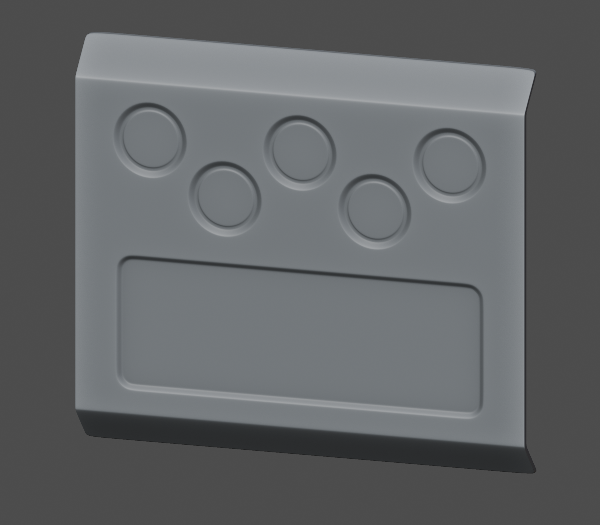
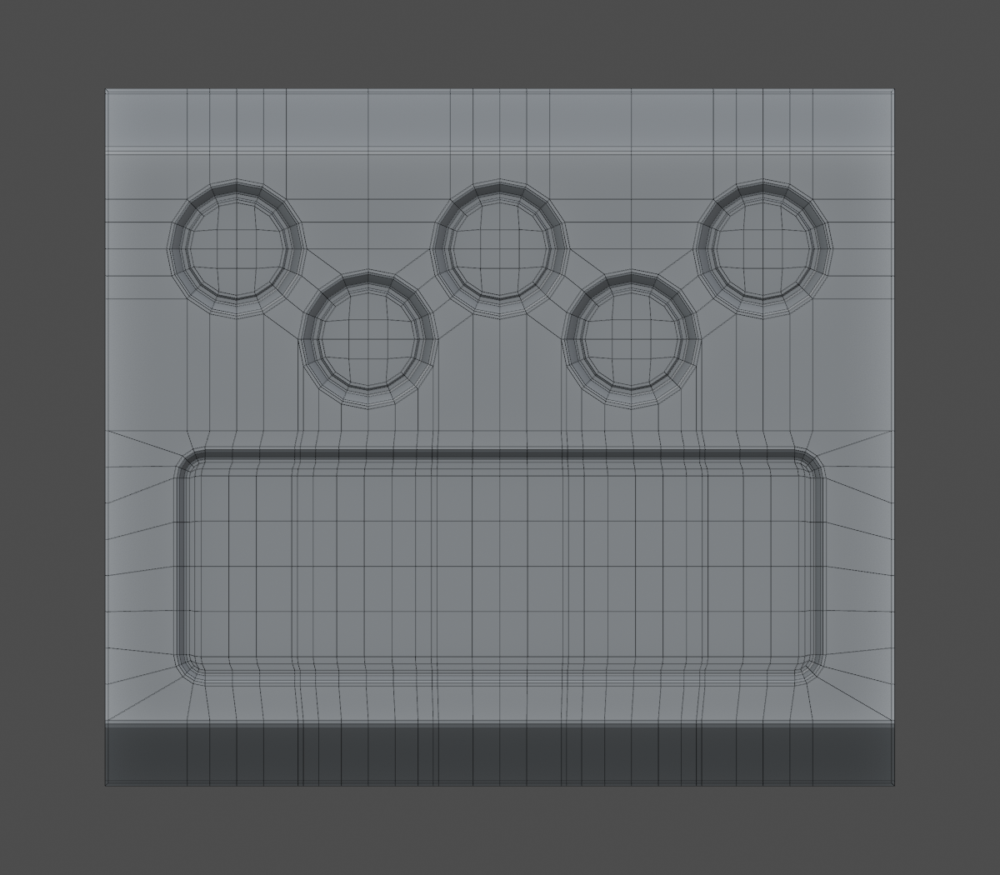

## [pipe](pipe/README.md)

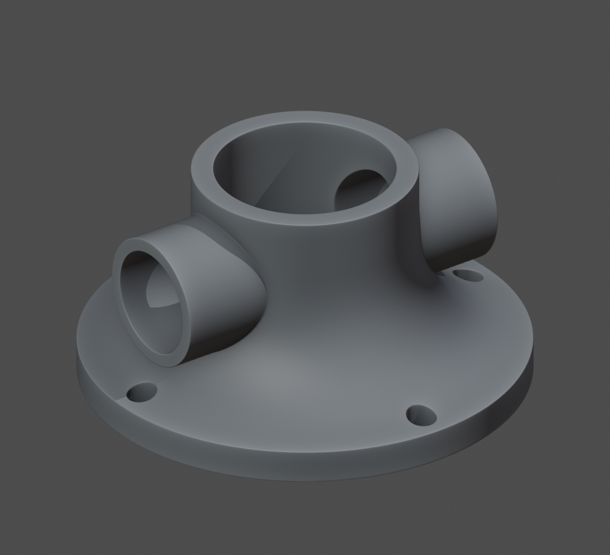
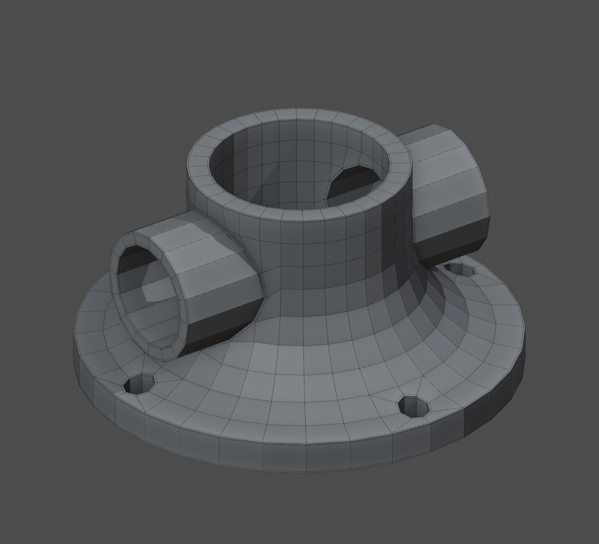

## [cover](cover/README.md)

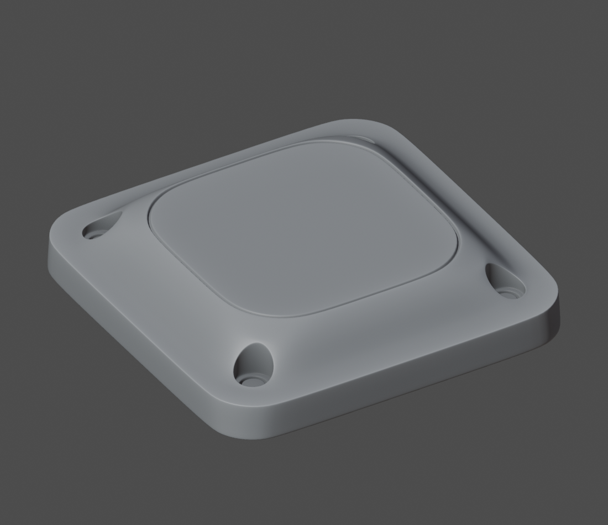
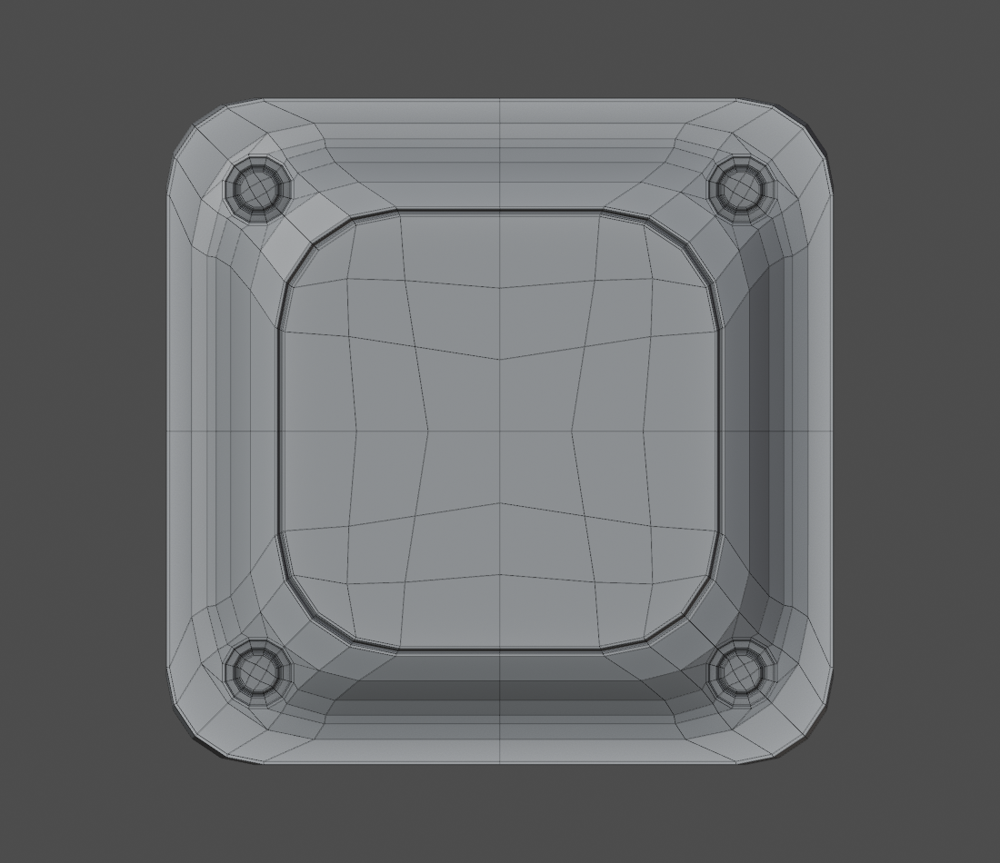

## [slotted-panel](slotted-panel/README.md)

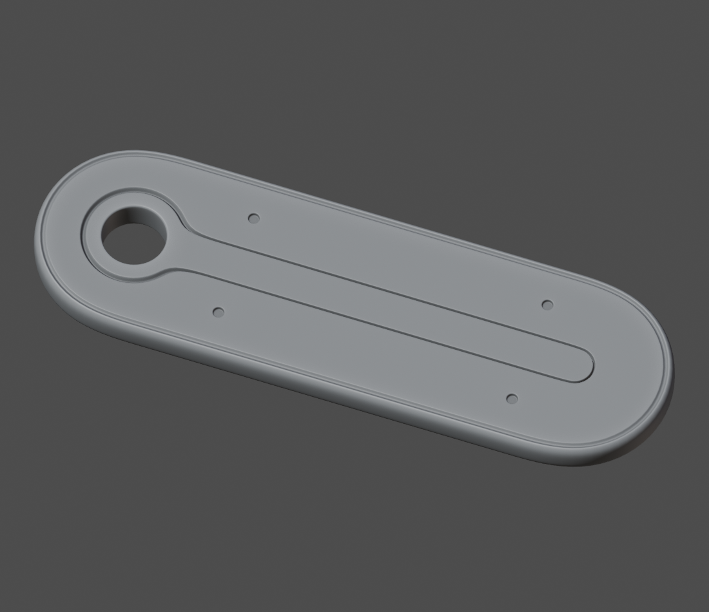
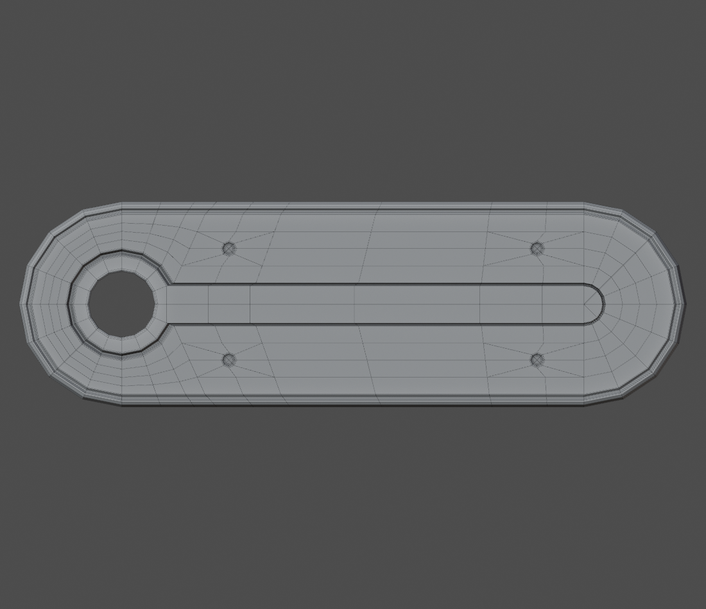

## [mechanical-joint](mechanical-joint/README.md)

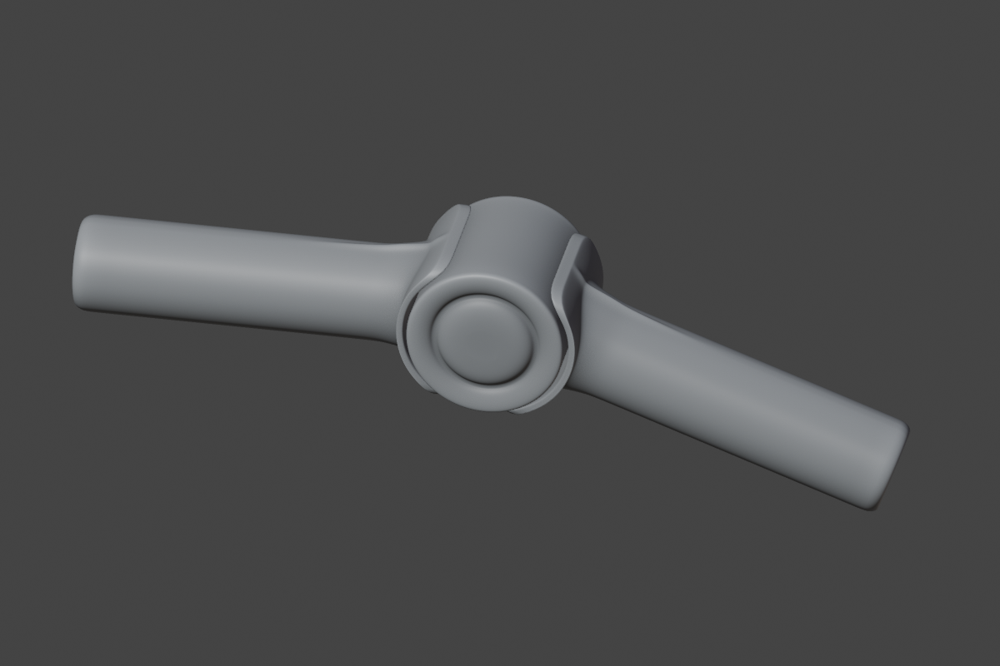
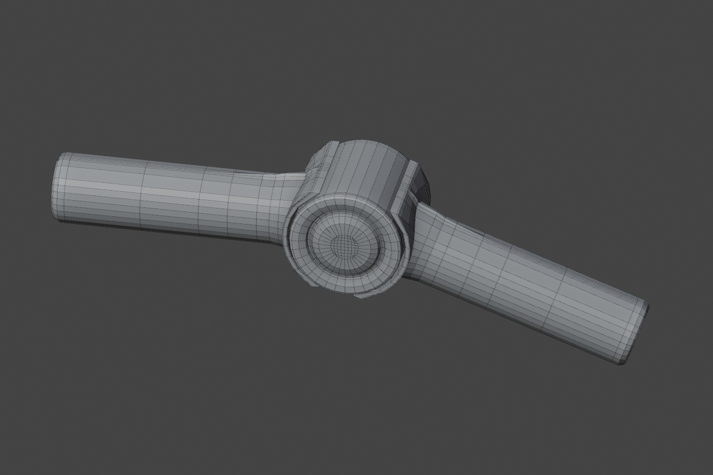

## [cylindrical-design](cylindrical-design/README.md)

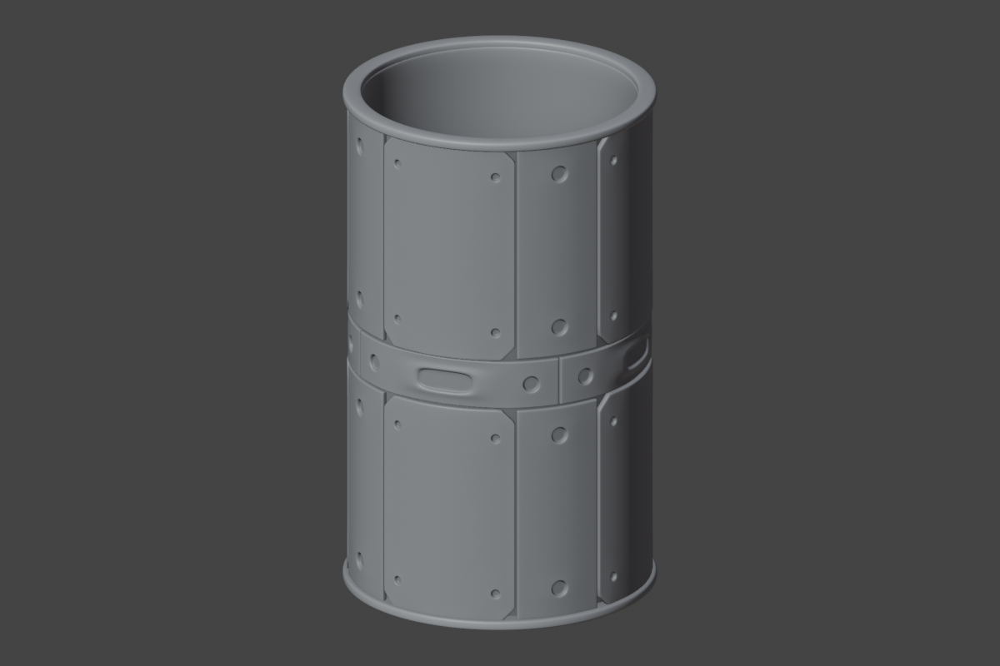
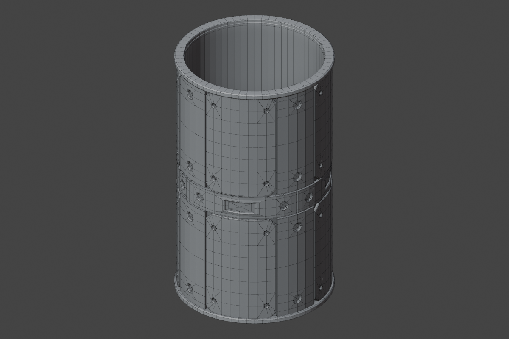
